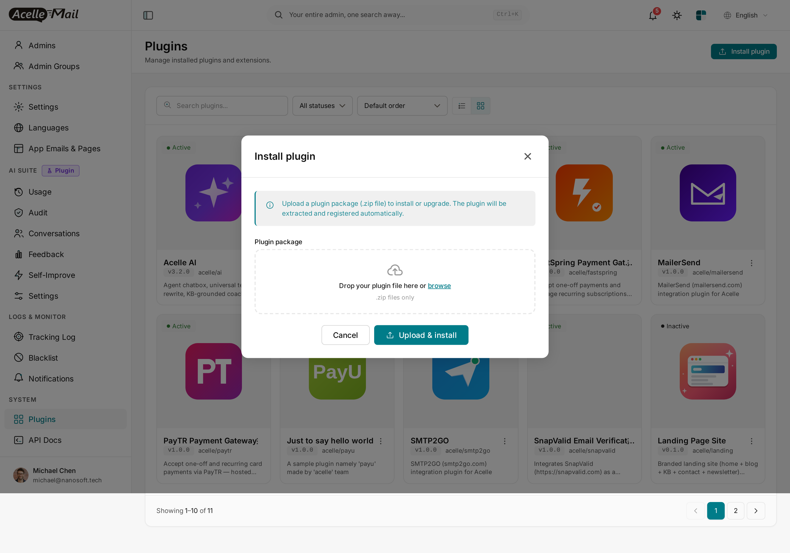
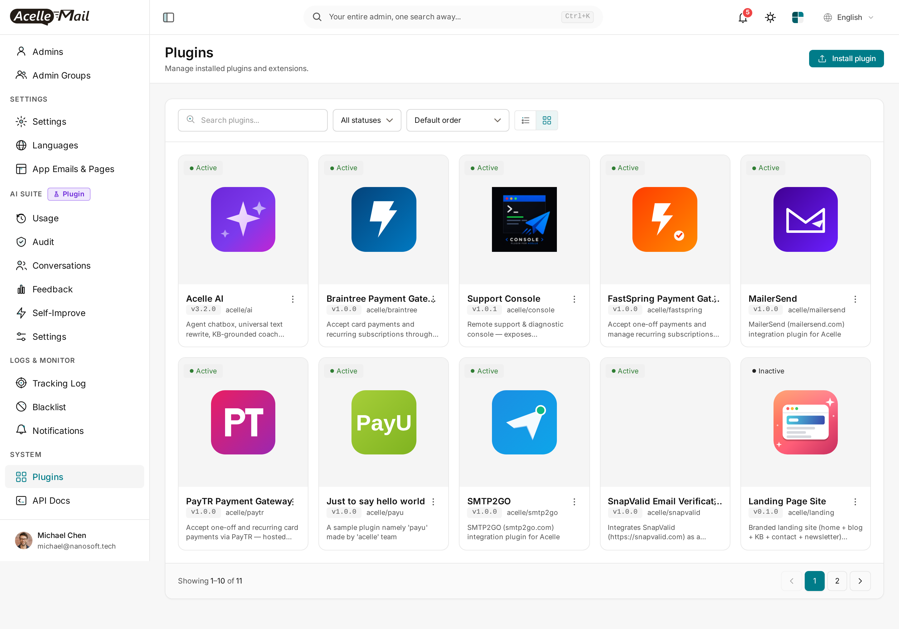
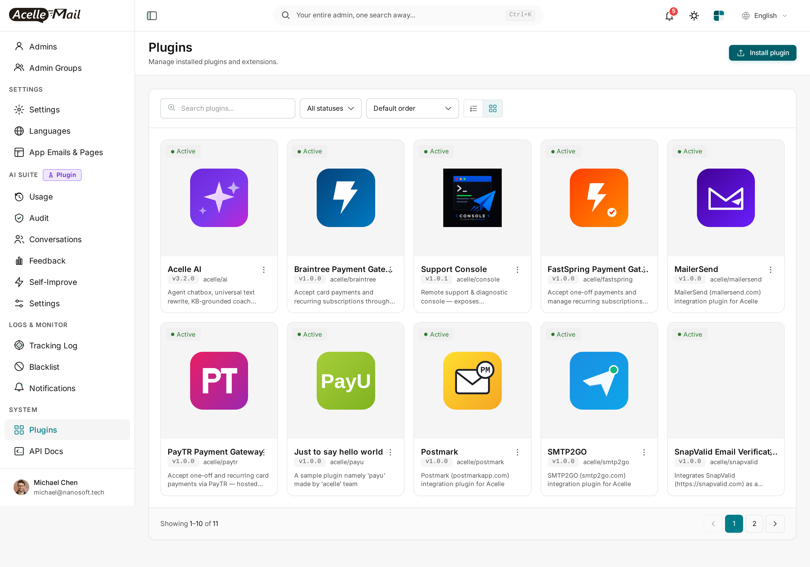
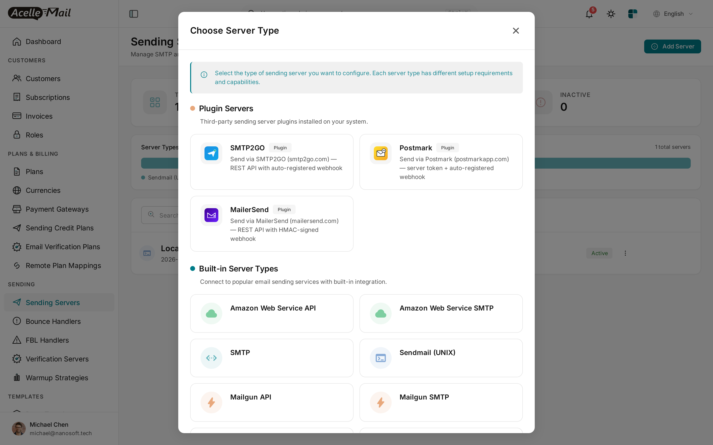
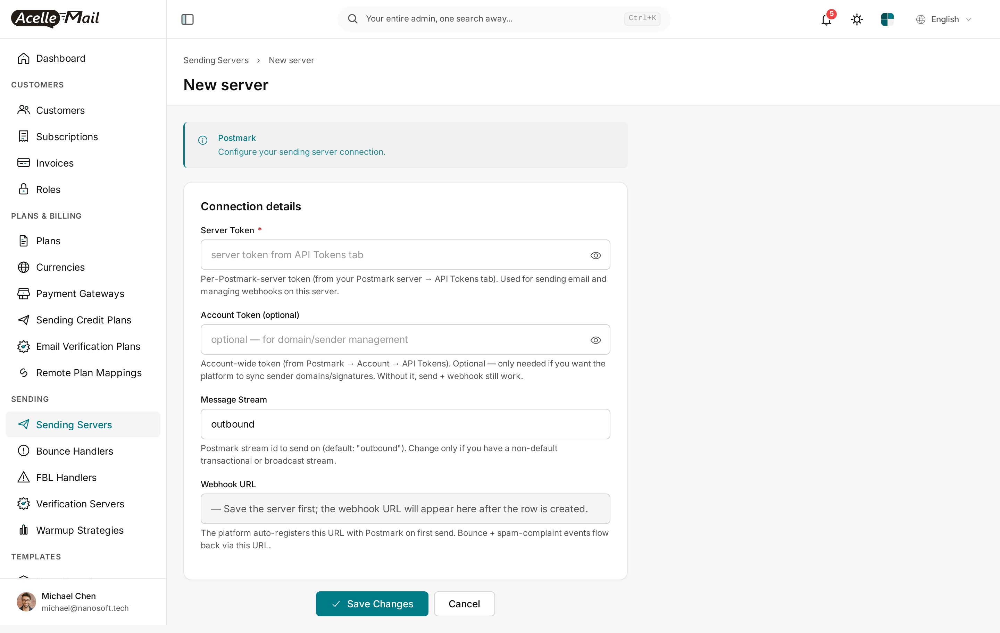
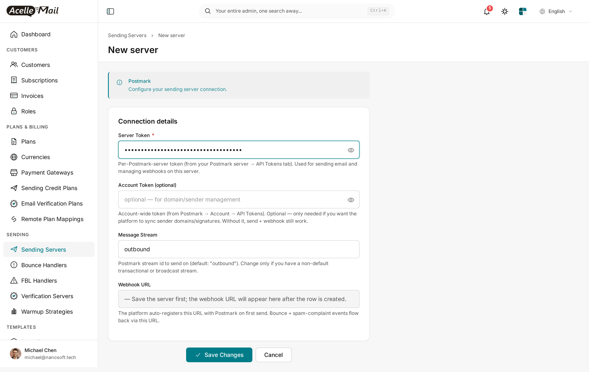

# Postmark for Acelle Mail — User Guide

A drop-in plugin that adds **Postmark** (`postmarkapp.com`) as a sending-server type in Acelle. Postmark is famous for **best-in-class transactional deliverability** — they're transactional-focused, IP-isolated, and refuse to onboard cold-email senders. If you care about emails landing in the Primary tab on Gmail, Postmark is the gold-standard backend. This plugin sends via Postmark's REST API and **auto-registers the bounce / spam webhook on first send**.

---

## Table of Contents

1. [Requirements](#1-requirements)
2. [Install the plugin](#2-install-the-plugin)
3. [Enable the plugin](#3-enable-the-plugin)
4. [Add Postmark as a sending server](#4-add-postmark-as-a-sending-server)
5. [Configure Server Token (+ optional Account Token + Message Stream)](#5-configure-server-token-optional-account-token-message-stream)
6. [Auto-registered webhook — how it works](#6-auto-registered-webhook-how-it-works)
7. [Sending identities (signatures + DKIM domains)](#7-sending-identities-signatures-dkim-domains)
8. [Test the connection](#8-test-the-connection)
9. [Assign the server to a plan or customer](#9-assign-the-server-to-a-plan-or-customer)
10. [Troubleshooting](#10-troubleshooting)
11. [Uninstall](#11-uninstall)

---

## 1. Requirements

| | Minimum |
|---|---|
| **Acelle Mail** | 4.2.0 or newer |
| **PHP** | 8.1+ |
| **Postmark account** | Free signup at [postmarkapp.com](https://postmarkapp.com). 100 free emails/month forever for accounts past approval. |
| **Server Token** | Per-Postmark-Server token from postmarkapp.com → Servers → your server → API Tokens. |
| **Outbound HTTPS** | Server must reach `api.postmarkapp.com` on port 443 |
| **Inbound HTTPS** | Acelle install reachable so Postmark can POST webhooks (URL auto-registered) |

> **Postmark's approval requirement.** New accounts go through a short manual review before you can send live (typically <24h on a weekday) to keep their sender reputation clean. Sandbox / testing is unblocked immediately.

---

## 2. Install the plugin

1. Download the plugin ZIP from your account's **Plugins** page.
2. **System → Plugins** → **Install plugin** → drop ZIP → **Upload & install**.

After install, **Postmark** appears as **Inactive**:

---

## 3. Enable the plugin

Find the **Postmark** card → ⋮ → **Enable**.

Card flips to **Active**:

---

## 4. Add Postmark as a sending server

**Sending → Sending Servers → + Add Server**.

Picker opens. Pick **Postmark** from the **Plugin Servers** group:

---

## 5. Configure Server Token (+ optional Account Token + Message Stream)

| Field | Value |
|---|---|
| **Name** | Label (e.g. `Postmark (transactional)`) |
| **Server Token** | Per-Postmark-Server token from your Postmark server → API Tokens tab. Used for sending + webhook management on this server. |
| **Account Token** *(optional)* | Account-wide token from Postmark → Account → API Tokens. Only needed if you want Acelle to sync sender domains / signatures. Send + webhooks still work without it. |
| **Message Stream** | Postmark stream id (default: `outbound` — the standard transactional stream). Change only if you have a non-default broadcast stream. |
| **Webhook URL** | *Read-only.* Populated after first send. |

Click **Save**. The plugin verifies the Server Token with a live `GET /server` probe — wrong token, inline error, row not saved.

> **Server Token vs Account Token — what's the difference?**
> Postmark has multiple servers per account (e.g. one for transactional, one for broadcast). Each server has its own token. The **Server Token** is what sends email and manages webhooks on that specific server. The **Account Token** is account-wide — only used here to call `/domains` and `/senders` for the identity-sync feature.

---

## 6. Auto-registered webhook — how it works

First time a campaign / automation / transactional email goes through this Postmark server, the plugin's `setupBeforeSend` hook fires:

1. Plugin calls Postmark's `POST /webhooks` with:
    - `Url`: `https://your-acelle-domain/webhook/acelle-postmark/{server_uid}`
    - `MessageStream`: the configured stream (default `outbound`).
    - `Triggers`: `Bounce`, `SpamComplaint`, `SubscriptionChange`.
2. Postmark returns a webhook id. Plugin stores `postmark_webhook_id` in the server config.
3. Every event Postmark emits is POSTed to your Acelle URL.

You never paste anything into Postmark's dashboard. The integration is fully automatic.

> **Postmark verifies the URL is reachable before saving.** If your Acelle install is behind a firewall or on `localhost`, the webhook registration call fails and you'll see an error. For local development, expose via ngrok / cloudflared and point Acelle's `APP_URL` at the tunnel.

---

## 7. Sending identities (signatures + DKIM domains)

Postmark has two identity kinds — both supported by this plugin **if you set the Account Token**:

| Kind | What it is | Use when |
|---|---|---|
| **Sender Signature** (email-level) | One specific email address verified via click-the-link confirmation | Quick start; sending from one address; no DKIM |
| **Domain** (full domain) | A full domain authenticated with DKIM CNAME records | Production sending; any local-part; required for high-volume + Primary-tab placement |

The plugin syncs both into Acelle's `sending_identities` table when an Account Token is present:

- **Two-way sync** — `GET /senders` + `GET /domains` reconcile with Acelle on every sync.
- **Add a domain from inside Acelle** — `POST /domains` fires when admin (or customer with permission) registers a new sending domain.
- **Re-verify on demand** — `PUT /domains/{id}/verifydkim` exposed as the **Re-check** button.

Without an Account Token, send + webhook still work but you'll manage signatures / domains directly in Postmark's dashboard.

### Why DKIM matters

With DKIM + SPF + DMARC alignment (Postmark's `/domains` API surfaces all three), receiving mailbox providers (Gmail, Outlook, Yahoo, Apple Mail) authenticate the message and place it in the Primary tab instead of Promotions / Spam.

---

## 8. Test the connection

**(a) Connection test** — built into the new-server form. Save handler runs a live `/server` probe against the Server Token.

**(b) Test send** — from the Sending Servers list, ⋮ → **Test send**. Single test email through the driver. **The first test send also triggers webhook auto-registration** — see [§6](#6-auto-registered-webhook-how-it-works).

---

## 9. Assign the server to a plan or customer

| Model | When to use |
|---|---|
| **System server, plan-attached** | Your Acelle SaaS sends on behalf of customers. Assign Postmark at **Admin → Plans → \[plan\] → Sending Servers**. |
| **Per-customer** | A customer brings their own Postmark account. They add the server from their own **Sending Servers** page. |

---

## 10. Troubleshooting

| Symptom | Likely cause | Fix |
|---|---|---|
| "401 Unauthorized" on save | Server Token wrong or revoked | Re-copy from Postmark → your server → API Tokens |
| First send fails with "Webhook registration failed" | Acelle install unreachable from Postmark's network | Acelle must be publicly reachable over HTTPS. For dev, use ngrok / cloudflared. |
| Sends rejected with "Inactive recipient" | Postmark's suppression list blocks the address | Check Postmark dashboard → Suppressions; reactivate if false-positive |
| Sends accepted but never delivered | New Postmark account still pending approval | Submit your account for review at postmarkapp.com → Account → Request approval. <24h on weekdays. |
| Identity sync fails with "Account Token required" | The Account Token field is blank | Either add an Account Token, or accept that identity management happens in Postmark's dashboard |
| Plugin Active but Postmark missing from picker | Stale opcache / view cache | `php artisan optimize:clear` and reload |

Plugin HTTP calls log to `storage/logs/laravel.log`.

---

## 11. Uninstall

1. **System → Plugins** → find **Postmark** → ⋮ → **Disable**. New sending servers can no longer be created with this driver; existing rows still work.
2. To remove files: ⋮ → **Delete**. Drops every `sending_servers` row of type `acelle-postmark`.

You may also want to disable the webhook in Postmark's dashboard manually.

---

## Support

- Documentation: this guide + plugin source code comments
- Questions & issues: contact **support@acellemail.com**

Postmark account / approval / domain-verification issues go to Postmark support directly.
